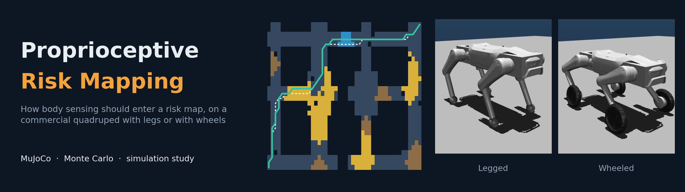
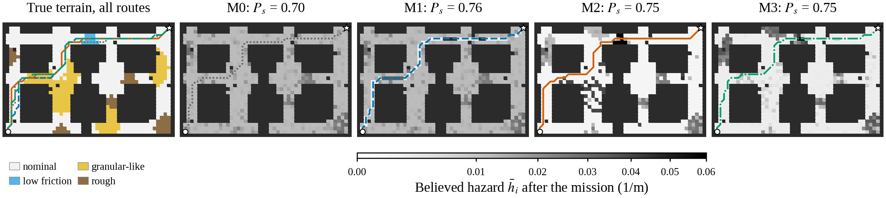
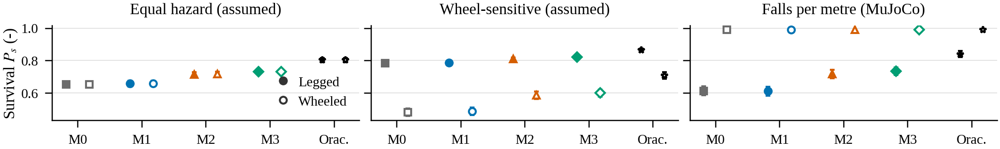
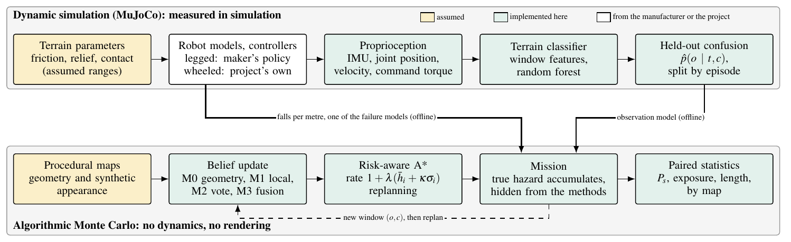
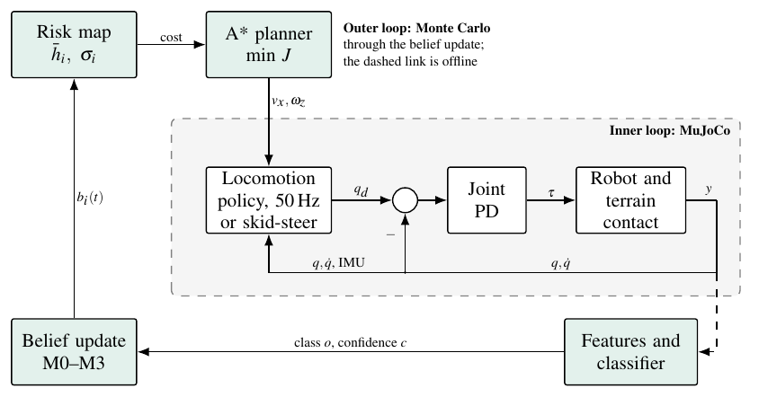
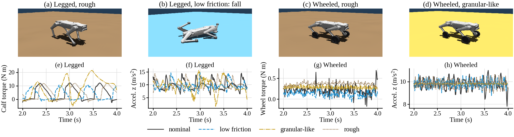

<div align="center">



<br/><br/>

**Mapas de riesgo aumentados con propiocepción para un cuadrúpedo comercial:<br/>navegación consciente del terreno con patas y con ruedas**

<sub>José Luis Segundo Manayay · Javier Yanpier Garay Yovera · Francisco Jesús Rodríguez Huiman</sub><br/>
<sub>Facultad de Ingeniería Mecánica · Universidad Nacional de Ingeniería (UNI) · Lima, Perú</sub>

<br/>


[](https://github.com/JoseSegundoM/proprioceptive_risk_mapping/actions/workflows/ci.yml)

[English](README.md) · **Español**

</div>

---

> La geometría dice poco sobre la fricción o la blandura: un piso mojado y un concreto seco dan el
> mismo perfil de LiDAR. El robot puede notar la diferencia con su cuerpo, pero solo cuando ya está
> encima. Este repositorio mide **cómo debe entrar esa evidencia al mapa de riesgo del planificador**,
> y si la respuesta depende de los pies.

El DOBOT Rover X1 usa módulos de patas y de ruedas que se cambian a mano, así que cada misión usa una
configuración fija; no se modela ningún cambio durante la misión. El estudio tiene dos partes: una
simulación dinámica en MuJoCo, que da un clasificador de terreno y tasas de caída simuladas, y un Monte
Carlo algorítmico, que compara cuatro reglas de actualización sobre los mismos mapas con estadística pareada.

> [!IMPORTANT]
> **Todos los resultados son de simulación.** Nada se midió en el robot físico y nada valida una mina
> real. La apariencia en el Monte Carlo es sintética, y el controlador de ruedas es propio del proyecto,
> no del fabricante.

---

## ✨ Resultados principales

Supervivencia de la misión `P_s`, 200 mapas de evaluación, error del clasificador ε = 0.1, tabla de
peligro asumida (media e intervalo bootstrap del 95 % de la diferencia pareada por mapa):

| Método | Supervivencia `P_s` | Exposición (m) | Diferencia | 200 mapas nuevos |
| --- | --- | --- | --- | --- |
| M0 solo geometría | 0.654 | 9.10 | | |
| M1 actualización bayesiana local | 0.657 | 9.03 | M1 − M0: +0.004 [+0.000, +0.007] | +0.001, el intervalo incluye 0 |
| M2 propagación por apariencia | 0.712 | 7.35 | M2 − M1: +0.055 [+0.043, +0.067] | +0.049 |
| M3 fusión con incertidumbre | 0.727 | 6.92 | M3 − M2: +0.015 [+0.008, +0.023] | +0.014 |
| Oráculo (cota diagnóstica) | 0.804 | 4.73 | | |

- **Propagar por apariencia es lo que eleva la supervivencia.** Actualizar solo lo pisado llega tarde.
  La ganancia desaparece cuando la mitad de las zonas se parecen o el ruido de apariencia es alto.
- **El modelo de fallo, no la percepción, decide qué configuración gana.** Con la confusión medida e igual
  peligro, la diferencia entre configuraciones es +0.002. Con caídas simuladas por metro, la ganancia es
  +0.106 con patas y +0.000 con ruedas, que nunca cayeron.
- **El clasificador interpola, pero no extrapola.** El macro-F1 en episodios no vistos es 0.935 (patas) y
  0.999 (ruedas), 0.820 y 0.842 en recorridos mixtos, y baja hasta 0.450 con patas a velocidades no vistas.

<div align="center">

<br/><sub>Un mapa de evaluación: terreno real con las cuatro rutas, y el peligro que cree cada método al final.</sub>
<br/><br/>

<br/><sub>Supervivencia con la confusión medida del clasificador, bajo tres modelos de fallo.</sub>
</div>

---

## 🏗️ Cómo está construido el estudio

<div align="center">

<br/><br/>

<br/><sub>El lazo interno corre en MuJoCo y el externo en el Monte Carlo. Se unen fuera de línea, no en un mismo simulador.</sub>
<br/><br/>

<br/><sub>Capturas de MuJoCo, con el color del suelo solo para distinguir el terreno, y señales en los cuatro terrenos.</sub>
</div>

---

## 🚀 Inicio rápido

Ubuntu 24.04, Python 3.12 y una distribución de LaTeX para el manuscrito.

```bash
git clone https://github.com/JoseSegundoM/proprioceptive_risk_mapping.git
cd proprioceptive_risk_mapping
python3 -m venv .venv && source .venv/bin/activate
pip install -r requirements.txt

python -m pytest tests -q                 # los tests de física se omiten sin los modelos del robot
python scripts/analyze_mc.py              # estadística desde las misiones registradas
python scripts/make_tables.py             # tablas y todas las cifras del texto
python scripts/generate_figures.py 12     # figuras
scripts/build_paper.sh                    # manuscrito
python scripts/verify_deliverables.py     # páginas, enlaces, citas, cifras
```

Cómo volver a correr el Monte Carlo o la captura en MuJoCo está en
[`docs/reproducibility.md`](docs/reproducibility.md). La captura necesita los modelos del robot de otro
repositorio del proyecto, que es privado; los datos registrados aquí no.

---

## 🗂️ Estructura del repositorio

```
assets/    imágenes de este README y el banner
configs/   definición de los experimentos Monte Carlo
data/      mapas de evaluación, resúmenes, características, episodios graficados
docs/      guía de reproducibilidad y protocolo de investigación
paper/     fuente LaTeX, figuras, tablas generadas, PDF compilados
results/   registros de misiones (E1-E8), estadística, métricas, sumas de verificación
scripts/   campañas, análisis, tablas, figuras, compilación y verificación
src/       riskmc (Monte Carlo) y physics (captura MuJoCo, clasificador)
tests/     pruebas unitarias, de integración y de determinismo
```

---

## 👥 Autores

| Autor | Correo | ORCID | GitHub |
| --- | --- | --- | --- |
| José Luis Segundo Manayay | [jose.segundo.m@uni.pe](mailto:jose.segundo.m@uni.pe) | [0009-0002-9203-8710](https://orcid.org/0009-0002-9203-8710) | [@JoseSegundoM](https://github.com/JoseSegundoM) |
| Javier Yanpier Garay Yovera | [javier.garay.y@uni.pe](mailto:javier.garay.y@uni.pe) | [0009-0001-1645-8724](https://orcid.org/0009-0001-1645-8724) | [@garx17](https://github.com/garx17) |
| Francisco Jesús Rodríguez Huiman | [francisco.rodriguez.h@uni.pe](mailto:francisco.rodriguez.h@uni.pe) | [0009-0006-6972-2484](https://orcid.org/0009-0006-6972-2484) | [@frodriguezhuiman-lgtm](https://github.com/frodriguezhuiman-lgtm) |

Facultad de Ingeniería Mecánica, Universidad Nacional de Ingeniería (UNI), Lima, Perú.

---

## 📄 Licencia

MIT, ver [`LICENSE`](LICENSE). Los componentes de terceros están en [`NOTICE`](NOTICE).

## 📚 Cita

Ver [`CITATION.cff`](CITATION.cff). El manuscrito está en [`paper/paper_final.pdf`](paper/paper_final.pdf).
