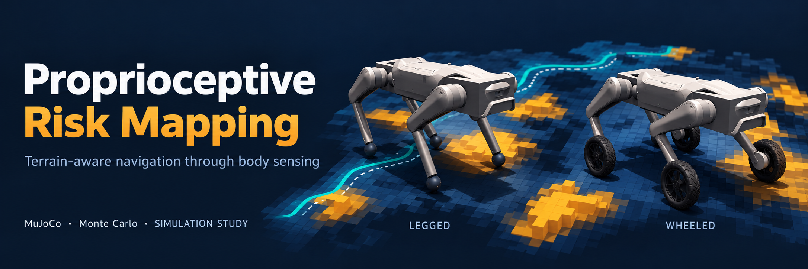
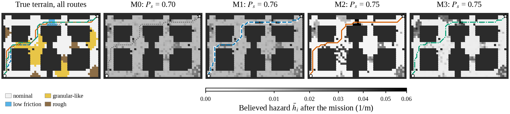
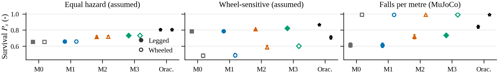
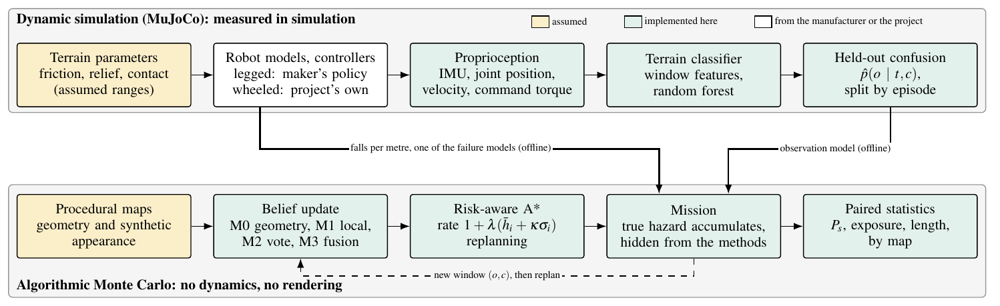
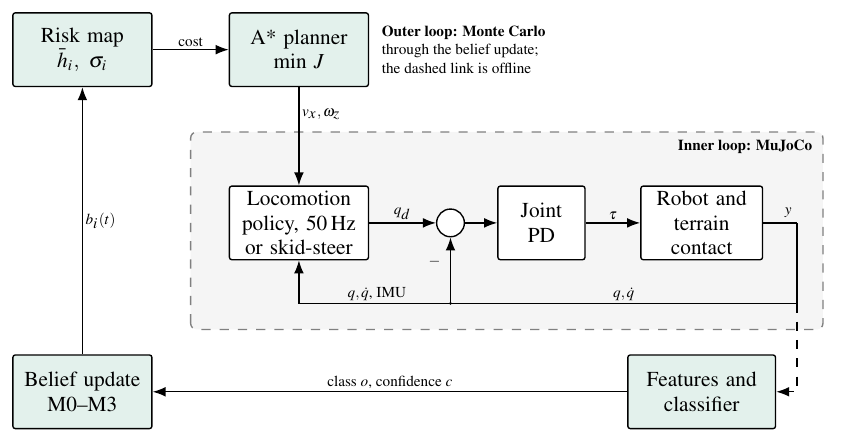
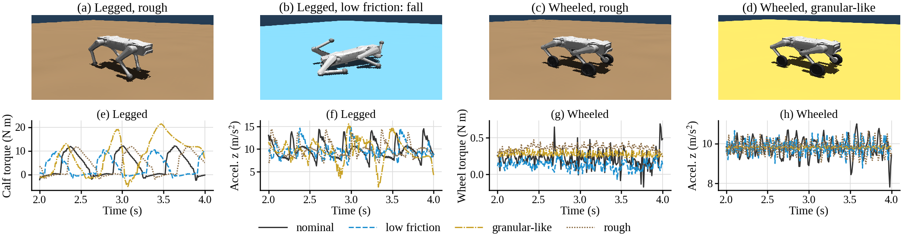

<div align="center">



<br/><br/>

**Proprioception-Augmented Risk Mapping for a Commercial Quadruped:<br/>Terrain-Aware Navigation Across Legged and Wheeled Configurations**

<sub>José Luis Segundo Manayay · Javier Yanpier Garay Yovera · Francisco Jesús Rodríguez Huiman</sub><br/>
<sub>Faculty of Mechanical Engineering · Universidad Nacional de Ingeniería (UNI) · Lima, Peru</sub>

<br/>


[](https://github.com/JoseSegundoM/proprioceptive_risk_mapping/actions/workflows/ci.yml)

</div>

---

> Geometry says little about friction or softness: a wet floor and dry concrete return the same
> LiDAR profile. A robot can feel the difference through its body, but only once it is standing on
> it. This repository measures **how that evidence should enter a planner's risk map**, and whether
> the answer depends on the feet.

The DOBOT Rover X1 uses point-foot and wheel modules exchanged by hand, so each mission uses one
fixed configuration; no switching during a mission is modelled. The study has two parts: dynamic
simulation in MuJoCo, which gives a terrain classifier and simulated fall rates, and an algorithmic
Monte Carlo, which compares four map-update rules on the same maps with paired statistics.

> [!IMPORTANT]
> **All results are simulation.** Nothing was measured on the physical robot and nothing validates a
> real mine. Appearance features in the Monte Carlo are synthetic, and the wheeled controller is this
> project's own, not the manufacturer's.

---

## ✨ Main results

Mission survival `P_s`, 200 evaluation maps, classifier error ε = 0.1, assumed hazard table
(mean and 95 % bootstrap interval of the paired difference over maps):

| Method | Survival `P_s` | Exposure (m) | Difference | 200 unseen maps |
| --- | --- | --- | --- | --- |
| M0 geometry only | 0.654 | 9.10 | | |
| M1 local Bayesian update | 0.657 | 9.03 | M1 − M0: +0.004 [+0.000, +0.007] | +0.001, interval includes 0 |
| M2 appearance propagation | 0.712 | 7.35 | M2 − M1: +0.055 [+0.043, +0.067] | +0.049 |
| M3 uncertainty-aware fusion | 0.727 | 6.92 | M3 − M2: +0.015 [+0.008, +0.023] | +0.014 |
| Oracle (diagnostic bound) | 0.804 | 4.73 | | |

- **Spreading evidence by appearance is what raises survival.** Updating only the crossed ground
  arrives too late to matter. The gain disappears when half the patches look alike or appearance noise is high.
- **The failure model, not perception, decides which configuration gains.** With measured confusion
  and equal hazards the difference between configurations is +0.002. With simulated falls per metre the gain is
  +0.106 for the legged model and +0.000 for the wheeled one, which never fell.
- **The classifier interpolates and does not extrapolate.** Macro-F1 on held-out episodes is 0.935 (legged)
  and 0.999 (wheeled), 0.820 and 0.842 on mixed courses, and as low as 0.450 for the legged model at unseen speeds.

<div align="center">

<br/><sub>One evaluation map: true terrain with the four routes, and the hazard each method believes at the end.</sub>
<br/><br/>

<br/><sub>Survival with measured classifier confusion under three failure models.</sub>
</div>

---

## 🏗️ How the study is built

<div align="center">

<br/><br/>

<br/><sub>The inner loop runs in MuJoCo and the outer loop in the Monte Carlo. They are joined offline, not closed online in one simulator.</sub>
<br/><br/>

<br/><sub>MuJoCo renders, with floor colour for display only, and logged signals on the four terrains.</sub>
</div>

---

## 🚀 Quick start

Ubuntu 24.04, Python 3.12, and a LaTeX distribution for the manuscript.

```bash
git clone https://github.com/JoseSegundoM/proprioceptive_risk_mapping.git
cd proprioceptive_risk_mapping
make setup      # virtual environment and dependencies
make test       # physics tests skip without the robot models
make analysis   # statistics and tables from the recorded missions
make paper      # manuscript, into paper/build/
make verify     # page count, links, citations, numbers
```

`make help` lists every target.

---

## 🔁 Reproducibility

Three levels, from least to most dependent:

| Level | Regenerates | Needs | Command |
| --- | --- | --- | --- |
| 1. Analysis | Statistics, tables and manuscript, from the recorded missions | This repository | `make analysis paper` |
| 2. Monte Carlo | Every mission of E1-E8, using the recorded classifier outputs | This repository, 16 threads, about 15 min | `make monte-carlo` |
| 3. Dynamics | Raw MuJoCo signals, features, classifier, renders | The robot models, about 6 min for the capture | `make models capture classifier figures` |

The robot models come from `mine_sentinel_autonomy`, a separate and private project repository, pinned to
the commit in the `Makefile`. Without access, levels 1 and 2 still work on the recorded data. Raw signals
(about 500 MB) are not stored here because they regenerate from their seeds; `data/examples/` keeps the
episodes plotted in the paper, and `results/manifest.json` records versions, seeds and checksums.

- **Checked:** `tests/test_determinism.py` regenerates mission rows and MuJoCo episodes and compares them with
  the records. In CI, the statistics and tables are regenerated and must match the committed files.
- **Not checked:** exact floating-point agreement on other machines or library versions for the full campaigns.
- **Departure from the robot repository:** MuJoCo physics and the wheeled stance PD run at 1 kHz in
  `src/physics/capture.py`, because at 200 Hz the stance PD produced a numerical limit cycle of about
  70 m/s² RMS at the IMU.

`paper/paper_final.pdf` is the submitted manuscript and builds never overwrite it; `make verify` checks that the
source still produces its text.

---

## 🧪 Protocol

Fixed before the evaluation campaigns. The statistical unit is the map; replicates are averaged within it.

| | Hypothesis | Refuted if |
| --- | --- | --- |
| H1 (primary) | M2 improves survival over M1 and M0 | The 95 % interval of the paired M2 − M1 includes or falls below 0 |
| H2 | M1 improves on M0 | The paired interval includes or falls below 0 |
| H3 | M3 improves on M2 under classification errors or ambiguous appearance | The interval of M3 − M2 includes or falls below 0 |
| H4 | Fusing IMU and joints beats each channel, by macro-F1 on unseen episodes | No improvement over the best channel in the paired interval |
| H5 | The propagation gain differs between configurations through measured confusion alone | The interval of the interaction includes 0 |

- **Primary metric:** `P_s = exp(−H)`, with `H` the true hazard integrated over the executed route, and 0 if the goal is not reached within budget.
- **Statistics:** paired bootstrap over maps (10 000 resamples), Wilcoxon with Holm correction, `d_z` and rank-biserial correlation.
- **Sets:** development maps 100000-100049 for tuning only; evaluation maps 0-199; unseen repetition maps 200000-200199. The classifier is split by episode, never by window.
- **Added after the protocol:** E5 (λ sweep, descriptive) and E8 (spatial baseline), after seeing E1-E4, to answer objections from an internal review. A 30-map smoke check on evaluation maps used default parameters and tuned nothing.

Contributions should say what was run, keep every run, including failed ones, and generate numbers rather than type them.

---

## 🗂️ Repository layout

```
├── assets/                  images of this README
├── configs/                 Monte Carlo experiment definitions
├── data/
│   ├── maps/                the 200 evaluation maps
│   ├── episodes/            per-episode summaries of the MuJoCo campaigns
│   ├── features/            classifier window features
│   └── examples/            raw episodes plotted in the paper
├── paper/
│   ├── paper_final.pdf      submitted manuscript
│   ├── main.tex, references.bib
│   ├── figures/             PDF for the paper, plus png/, svg/, diagrams/, renders/, photos/
│   ├── tables/              generated tables and values
│   └── template/            IEEE class and style
├── results/
│   ├── monte_carlo/         one row per mission, experiments E1-E8
│   ├── statistics/          summaries and paired comparisons
│   ├── classifier/          metrics, confusion, fall rates
│   └── manifest.json        versions, seeds, checksums
├── scripts/
│   ├── experiments/         capture, classifier, Monte Carlo, renders
│   ├── analysis/            statistics, tables, figures
│   └── paper/               build, bibliography, checks
├── src/
│   ├── riskmc/              maps, belief updates M0-M3, risk-aware A*, statistics
│   └── physics/             terrains, capture, features, classifier
├── tests/
└── Makefile                 entry point for everything above
```

---

## 👥 Authors

| Author | E-mail | ORCID | GitHub |
| --- | --- | --- | --- |
| José Luis Segundo Manayay | [jose.segundo.m@uni.pe](mailto:jose.segundo.m@uni.pe) | [0009-0002-9203-8710](https://orcid.org/0009-0002-9203-8710) | [@JoseSegundoM](https://github.com/JoseSegundoM) |
| Javier Yanpier Garay Yovera | [javier.garay.y@uni.pe](mailto:javier.garay.y@uni.pe) | [0009-0001-1645-8724](https://orcid.org/0009-0001-1645-8724) | [@garx17](https://github.com/garx17) |
| Francisco Jesús Rodríguez Huiman | [francisco.rodriguez.h@uni.pe](mailto:francisco.rodriguez.h@uni.pe) | [0009-0006-6972-2484](https://orcid.org/0009-0006-6972-2484) | [@frodriguezhuiman-lgtm](https://github.com/frodriguezhuiman-lgtm) |

Faculty of Mechanical Engineering, Universidad Nacional de Ingeniería (UNI), Lima, Peru.

---

## 📄 License

MIT, see [`LICENSE`](LICENSE). Third-party components and the photographs, which the licence does not cover, are listed in [`NOTICE`](NOTICE).

## 📚 Citation

See [`CITATION.cff`](CITATION.cff). The manuscript is in [`paper/paper_final.pdf`](paper/paper_final.pdf).
